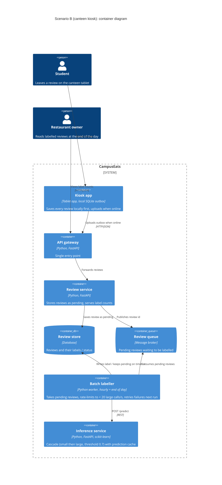

# Task 4: Deployment topologies and trade-offs

**Name / ชื่อ:** Chatrin Yoonchalard

**Student ID / รหัสนิสิต:** 6631304721

This is **individual work**: each student completes and submits their own copy, in their own fork.

*งานนี้เป็น**งานเดี่ยว** นิสิตแต่ละคนทำและส่งงานของตัวเอง ใน fork ของตัวเอง*

**Scenario (A, B or C) / Scenario ที่เลือก:** B. Canteen kiosk

Choose **one** scenario below. If the last digit of your student ID is odd, take A or B; if it is even, take B or C. Use your measurements from Tutorial 6 as evidence: cite run names from `results/runs.csv`. Answer in Thai or English.

เลือก scenario **หนึ่ง** ข้อด้านล่าง ถ้าเลขตัวสุดท้ายของรหัสนิสิตเป็นเลขคี่ ให้เลือก A หรือ B ถ้าเป็นเลขคู่ ให้เลือก B หรือ C ใช้ผลการวัดจาก tutorial ที่ทำไปเป็นข้อมูลอ้างอิง โดยอ้างชื่อ run จาก `results/runs.csv` จะตอบเป็นภาษาไทยหรือภาษาอังกฤษก็ได้

Facts that hold in every scenario / ข้อเท็จจริงที่ใช้กับทุก scenario:

- The large model serves at most **20 calls per second** (4 calls at once × about 200 ms each), and every call costs money.

  *large model รับได้สูงสุด **20 calls ต่อวินาที** (พร้อมกัน 4 calls × ประมาณ 200 ms ต่อ call) และทุก call มีค่าใช้จ่าย*
- The small model is fast and cheap enough to run anywhere, including inside the review service or on a kiosk, but it is much less accurate on its own.

  *small model เร็วและถูกพอที่จะรันที่ไหนก็ได้ รวมถึงภายใน review service หรือบน kiosk แต่ถ้าใช้ตัวเดียวจะแม่นน้อยกว่ามาก*

## Scenarios

**A. Owner alerts.** When a customer posts a negative review, the restaurant owner gets a push notification within **2 seconds**. At the lunch peak, CampusEats receives **40 reviews per second**. A missed alert is acceptable, but a wrong alert (for example, "your customer is unhappy" when they are happy) makes owners stop trusting alerts and, in the end, ignore them.

*เมื่อลูกค้าโพสต์รีวิวเชิงลบ เจ้าของร้านจะต้องได้รับ push notification ภายใน **2 วินาที** เวลาช่วงพีคตอนเที่ยง CampusEats ได้รับรีวิวจำนวน **40 รายการต่อวินาที** การพลาด alert ไปบ้างนั้นยอมรับได้ แต่ alert ที่ผิด (เช่น "ลูกค้าไม่พอใจ" ทั้งที่จริงๆ แล้วพอใจ) จะทำให้เจ้าของร้านไม่เชื่อถือและเลิกสนใจ alert ในที่สุด*

**B. Canteen kiosk.** A tablet in each canteen lets students leave a review on the spot. However, the canteen Wi-Fi is poor: the tablets lose their connection several times a day, for minutes at a time. The system must accept every review, even while a tablet is offline. Restaurant owners need the labels **by the end of the day**.

*มี tablet ในแต่ละโรงอาหารให้นิสิตรีวิวได้ทันที อย่างไรก็ดี การเชื่อมต่อ Wi-Fi ในโรงอาหารไม่ดี ทำให้ tablet หลุดการเชื่อมต่อวันละหลายครั้ง ครั้งละหลายนาที ระบบจะต้องรับรีวิวได้ทุกรายการแม้ขณะที่กำลัง offline อยู่ และเจ้าของร้านต้องการ label **ภายในสิ้นวัน***

**C. Weekly report.** Restaurant owners want a weekly sentiment report. Nothing in producing this report has to be real-time. **Accuracy matters most** and **cost must be minimal**.

*เจ้าของร้านต้องการรายงาน sentiment รายสัปดาห์ ไม่มีอะไรที่จะต้องทำแบบ real-time ในการออกรายงานนี้ ความแม่นยำ **(accuracy) สำคัญที่สุด** และ **ค่าใช้จ่ายต้องน้อยที่สุด***

## Topologies and patterns to choose from / Topology และ pattern ที่เลือกใช้ได้

| | Topology | Where the model runs / โมเดลรันที่ไหน |
|---|---|---|
| T1 | Model as a service, synchronous | Inference service, called for each review (today's baseline) *inference service ถูกเรียกทุกรีวิว (baseline ของวันนี้)* |
| T2 | Model as a library | Inside the review service, or on the device *ภายใน review service หรือบนอุปกรณ์* |
| T3 | Hybrid | Small model locally, large model as a remote service *small model รันในเครื่อง large model เป็น remote service* |
| T4 | Asynchronous / batch | Reviews are queued (broker, W10) or stored, and scored later in bulk *รีวิวถูกเข้าคิว (broker, W10) หรือเก็บไว้ แล้วติด label ทีหลังเป็นชุด* |

Combine one topology with any of the patterns from Tutorial 6: **fallback**, **cascade** and **cache**.

*เลือก topology หนึ่งแบบ แล้วผสมกับ pattern จาก Tutorial 6 ได้ตามต้องการ: **fallback**, **cascade** และ **cache***

## 1. Quality requirements

The three most important quality requirements for your scenario, each with a number where possible.

*quality requirements ที่สำคัญที่สุด 3 ข้อของ scenario ที่เลือก ระบุตัวเลขเมื่อทำได้*

| # | Quality | Requirement |
|---|---|---|
| 1 | Availability / durability | 100% of reviews are accepted and none are lost, including during Wi-Fi outages of several minutes (the kiosk stores reviews locally until it can upload them). |
| 2 | Accuracy | At least 90% of labels are correct (same as QR3), so the small model alone (72.5%) is not enough. |
| 3 | Timeliness and cost | Every review is labelled by the end of the day (e.g. 23:59), using as few large-model calls as possible and never more than 20 calls/s. |
## 2. Design / การออกแบบ

Your topology, the patterns you add, and a container-level diagram (C4 level 2). The C4 diagram must be written in Mermaid.

*topology ที่เลือก pattern ที่เพิ่ม และ diagram ระดับ container (C4 level 2) เขียนด้วย Mermaid*

**Topology:** T4 Asynchronous / batch. **Patterns:** cascade (threshold 0.7) + cache inside the batch job, and fallback (timeout -> leave as `pending`, retry in the next batch).

The kiosk saves every review in a local outbox first, so it works offline. When Wi-Fi returns, it uploads the outbox. The review service stores each review as `pending` and puts it on a queue. A batch labeller runs every hour (and once more before end of day) and labels pending reviews through the inference service, rate-limited below 20 large calls/s.

Threshold 0.7 here instead of the 0.6 chosen in Q2.1: 0.6 was chosen for real-time latency, but in a batch job latency does not matter, so the extra accuracy (93.0% vs 91.5%, t2-0.7 vs t2-0.6) is worth it.

## 3. Evidence / หลักฐาน

Which runs support your choice? Show the numbers and, for scenario A, the capacity arithmetic: how many large-model calls per second does your design need at the peak?

*run ไหนที่สนับสนุนการตัดสินใจของนิสิต ให้นิสิตแสดงตัวเลขประกอบ และสำหรับ scenario A ให้นิสิตแสดงการคำนวณ capacity ด้วย เพื่อแสดงว่าในช่วงพีคนั้น design ของนิสิตต้องใช้ large model กี่ calls ต่อวินาที*

| Run | What it shows / แสดงอะไร |
|---|---|
| t0-small | Small model alone: 72.5% accuracy. Running only the small model on the kiosk (T2) fails the 90% accuracy requirement. |
| t0-large | Large model for everything: 93.5% accuracy but 100% large calls, the most expensive option. |
| t2-0.7 | Cascade at 0.7: 93.0% accuracy with only 53% large calls. Its p95 (587 ms) doesn't matter here, because labels are only needed by end of day. |
| t3-cache | Cascade 0.7 + cache: 93.0% accuracy, large calls down to 38%, 35% cache hits. Repeated short kiosk reviews ("อร่อย", "Too salty") are cheap. |
| t1-after | Fallback turns 10% hangs into 28 pending reviews and 0 errors. In batch, pending reviews are simply retried in the next run, so nothing is lost. |

Capacity: even if the whole campus sends 5,000 kiosk reviews in a day, 38% large calls = 1,900 calls. At the 20 calls/s limit that is about 95 s of large-model time per day, so hourly batches finish easily before end of day.

## 4. ADR

Use the ADR format from W5.

*ใช้รูปแบบ ADR จาก W5*

**Title:** Label canteen kiosk reviews with an asynchronous batch job (T4) using cascade + cache

**Status:** Proposed

**Context:** Canteen tablets lose Wi-Fi several times a day for minutes at a time, but every review must be accepted and owners need labels only by the end of the day. Labels must be at least 90% correct, and the large model is limited to 20 calls/s and costs money per call. The small model alone reaches only 72.5% (t0-small).

**Decision:** The kiosk writes every review to a local outbox and uploads it when online. The review service stores it as `pending` and queues it. A batch labeller runs hourly and before end of day, calling the inference service with cascade (threshold 0.7) and the prediction cache, rate-limited below 20 large calls/s. Calls that time out stay `pending` and are retried in the next run (fallback).

**Consequences:**
- Positive: No review is lost during Wi-Fi outages; accuracy about 93% (t2-0.7, t3-cache); only about 38% of reviews reach the large model (t3-cache), so cost is low; large-model capacity is never exceeded because the batch controls its own rate; a slow or hung large model only delays labels, it never blocks a student.
- Negative: Labels arrive up to an hour late, so owners cannot react in real time; more moving parts (kiosk outbox, broker, batch worker) to build and monitor; the kiosk needs local storage and duplicate-safe uploads (idempotent review ids) in case an upload is retried.

**Alternatives considered:** at least one topology you rejected, and why.

*อย่างน้อยหนึ่ง topology ที่ไม่เลือก และเหตุผล*

> **T1 (synchronous model as a service):** rejected, because every review needs the network at the moment it is written, so reviews are lost or rejected while the tablet is offline, and it pays real-time cost for labels nobody needs until evening.
> **T2 (small model on the kiosk only):** rejected, because it works offline but gives only 72.5% accuracy, below the 90% requirement.
> **T3 (hybrid: small model on kiosk, large remote):** rejected for now. It could show a label instantly, but owners don't need that, and the hard reviews still need the network, so the kiosk would still need an outbox and a batch path, adding complexity without meeting any extra requirement.
